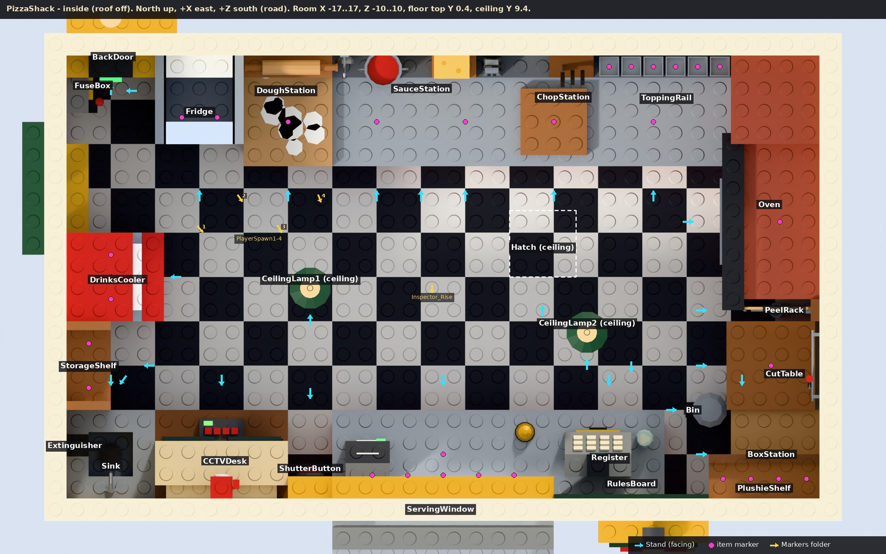
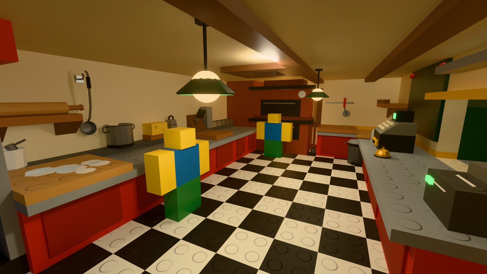
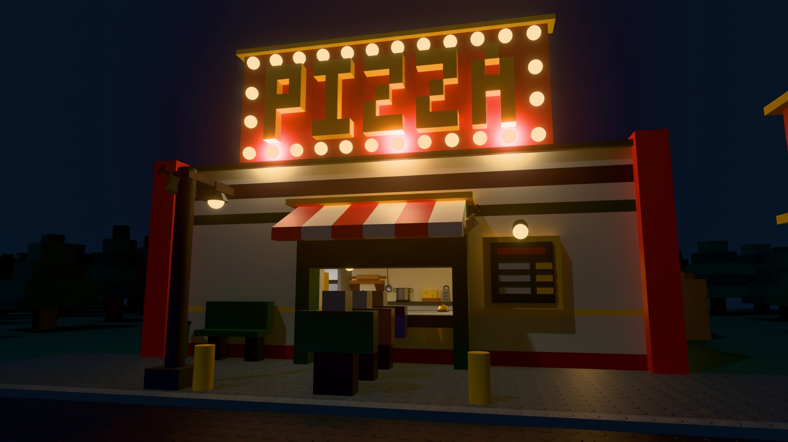

# Scary Pizza Shack - batch 1: the shack map, its stations and the hand-held items

A lonely roadside pizza shack at night, built brick by brick in the classic Roblox stud
style. This batch is the map, every station inside and outside, all the markers your
code reads, and the 46 hand-held items.

| file | what |
|---|---|
| `out/ScaryPizzaShack_Batch1.fbx` | 156 low-poly meshes, one per colour part, white material, named `Model__Part`, plus the four `FV_Axis` marker cubes |
| `out/BuildPizzaShack.lua` | the self-contained build script (runs unattended, safe to run twice) |
| `previews/plan_inside.jpg` | top-down plan of the inside with every station, Stand and item marker labelled |
| `previews/plan_site.jpg`, `previews/plan_world.jpg` | site plan (yard, front, road) and the whole map, with the Markers folder labelled |
| `previews/interior.jpg`, `previews/interior_2.jpg`, `previews/front_night.jpg`, `previews/yard_night.jpg`, `previews/aerial.jpg` | the look: the kitchen from both ends, the front and the yard at night, and a daytime aerial for reading the layout |
| `previews/stations_sheet.jpg`, `previews/items_sheet.jpg` | every station seen from its Stand, every item |

## Changed after your batch-1 notes

You applied these at import; the source now matches, so a rebuild gives the same map.

1. **ToppingRail:** the `GuardPost` that stood in Tub1 is gone (it was meant to carry a
   sneeze-guard bar that never got built).
2. **PlayerSpawn1..4** stand on the open floor at (-11, 0.4, -2.2), (-9.2, 0.4, -3.6),
   (-7.4, 0.4, -2.2) and (-5.6, 0.4, -3.6), each looking at the serving window.
3. **Shelf numbering:** Fridge `Slot1`/`Slot2` (dough, cheese) on the second shelf from the
   top, `Slot3`/`Slot4` on the third, `Slot5`/`Slot6` on the top shelf, `Slot7`/`Slot8` at
   the bottom (west slot first in each row). StorageShelf `Slot1`/`Slot2` (flour, sauce
   cans) on the middle shelf, `Slot3`/`Slot4` (flashlights) on the bottom one, `Slot5`/
   `Slot6` on the top.
4. **Extinguisher** is its own station: the wall bracket in the corner over the sink, a
   small black `Cradle` the extinguisher stands on, `Slot` on the cradle (facing into the
   room) and a `Stand` in front of the sink. The FireExtinguisher prop is gone from the
   Sink; `item:PivotTo(Slot.CFrame * item.Handle.Rest.CFrame:Inverse())` hangs the item
   exactly where the prop used to be.

## Running it

1. Upload `ScaryPizzaShack_Batch1.fbx` with Open Cloud (asset type Model), load it with
   `InsertService:LoadAsset(id)` and parent the result anywhere under Workspace.
2. Run `BuildPizzaShack.lua` with `loadstring` from the command-bar context. It prints
   `PizzaShack: built Workspace.PizzaShack: 2080 parts, 216 mesh parts, 123 markers, removed 1 import container(s)`.

What it does, in order:

* finds the imported MeshParts **by name anywhere under Workspace** (also ServerStorage
  and ReplicatedStorage; exact name first, then case/punctuation-insensitive);
* measures the four `FV_Axis` cubes to undo any scale or turn the importer applied;
* keeps a clean copy of every mesh in `ServerStorage.PizzaShackMeshes` (so it can be run
  again later without importing; delete that folder whenever you like, a fresh import
  rebuilds it);
* builds a new `Workspace.PizzaShack` with the folders `Shack`, `Outside`, `Stations`,
  `Items`, `Markers`, then deletes the one an earlier run built;
* deletes the import container (the outermost ancestor that holds nothing but imported
  meshes) and the marker cubes.

If any mesh is missing it warns and changes nothing. No Selection, no paste steps, no
plugins. Because a re-run replaces `Workspace.PizzaShack` completely, keep anything you add
in Studio (scripts, prompts, sounds) outside that folder or add it from code at run time.

It has been run in a strict Studio stand-in (`tools/mock_studio.lua`, unknown
classes / properties / enum members are errors) for a plain import, an import scaled by
0.01, an import turned on the CFrames, one turned inside the meshes, a second run with no
import (uses the cache) and a third with a new turned import: every one of the 3,000-odd
instances was compared with the source data (class, name, size, CFrame, colour, material,
flags, surfaces, PivotOffset, welds, joints, attachments, lights, attributes): 0 problems.

## Conventions (what your code can rely on)

* **Units and axes.** 1 stud; Roblox axes everywhere: +X east, +Y up, +Z south (towards
  the road). Ground top is Y 0, the shack floor top is Y 0.4, the road surface Y -0.4.
* **Markers** are invisible anchored 1 x 1 x 1 Parts (Transparency 1, CanCollide /
  CanQuery / CanTouch / CastShadow false). Their **-Z is the facing direction** and their
  **Position lies exactly on the surface they mark** (floor, ground, counter top, board,
  shelf, tub floor, deck floor), so half the cube is sunk into it. Character markers:
  put the character's feet at the marker. Camera markers: the camera's position, -Z = the
  view direction.
* **Item markers** (`Work`, `WorkSauce`, `WorkCheese`, `Handover`, `Slot..`, `Tub..`,
  `Delivery_Drop`, and the items' own `Carry` / `Inside`) face the same way as the
  station's `Stand`, so an item set down keeps the orientation it had in the player's
  hand (one exception: `Extinguisher.Slot` faces into the room, so the extinguisher hangs
  the way it always did). All 48 station item markers are checked by the build to sit
  exactly on their surface.
* **Brick grid.** Every Block and Wedge Part has X and Z in whole studs and Y in multiples
  of 0.4 (checked: 0 exceptions). Blocks are Plastic with TopSurface Studs, BottomSurface
  Inlet and Smooth sides; wedges have an Inlet bottom and a smooth slope. Deliberate
  exceptions: markers, the items' invisible Handles (0.4 cubes), the two display faces
  (`RulesBoard.Face` 7 x 5 x 0.2 and the monitor `Screen`s 2.4 x 1.8 x 0.2, SmoothPlastic),
  glass panes and Neon light strips; cylinders and balls are sized by their diameter.
  Thin upright panels (fridge and cooler sides, oven doors, glass) are 0.4 plates turned
  on their side, with smooth faces. Parts may overlap where bricks meet (counters run
  0.6 into walls, walls sink 0.2 into the ground); nothing z-fights (checked).
* **Moving pieces** are one anchored Part or MeshPart each, with **PivotOffset on the
  hinge or slide axis** and a pivot frame that is aligned with the world axes when the
  piece is at rest. Small things that move with them (handles, slats, a window) are
  welded to them (WeldConstraint, unanchored, massless), so `piece:PivotTo(...)` or
  setting its CFrame carries everything along. Example for a hinge:
  `door:PivotTo(door:GetPivot() * CFrame.Angles(0, math.rad(90), 0))`. Every moving piece,
  its direction and its distance is in the station table below.
* **Lights.** The bulbs that should light something carry a light named `Light`
  (PointLight / SpotLight / SurfaceLight): the PIZZA sign (3 of its 28 Bulbs), the two
  ceiling lamps, both oven Glows, fridge and cooler strips, the back-door lamp, street
  lamp, yard lamp and bus-stop tube. Change, flicker or delete them freely; everything
  named `Bulb` is a separate Neon ball you can recolour or switch to SmoothPlastic.
* **Items** live in `Workspace.PizzaShack.Items` as templates, well under the map (Y -60).
  Each is a Model whose PrimaryPart is an invisible `Handle` at the item's grip; -Z points
  away from the body, +Y up. The Handle is anchored; every other part is welded to it
  (unanchored, massless, CanCollide false), so clone the Model, set `Handle.Anchored =
  false` and weld the Handle to the hand. Every Handle has an Attachment **`Rest`**: where
  (and which way up) the item touches a surface when it is set down, so
  `item:PivotTo(marker.CFrame * item.Handle.Rest.CFrame:Inverse())` puts any item on any
  item marker. The pizza layers share one origin (pizza centre, bottom): stack them by
  giving their Handles the same CFrame; toppings sit at Y +0.24 above it (on the melted
  cheese) with their own Handle at their bottom.








## The map at a glance

* **Shack:** outer footprint X -18..18, Z -11..11 (walls 1 thick), so the room inside is
  **34 x 20** (X -17..17, Z -10..10), the largest your addendum allowed: every work spot has
  4 studs of counter of its own and the middle stays empty. Floor top Y 0.4 (2 x 2 black and
  white checker tiles), ceiling Y 9.4 (9 above the floor), a dark 2.4-tall attic over it,
  flat roof Y 12.2..13.4 with parapet and green coping, red corner pilasters, a brick
  chimney from the oven up through the roof, and the big brick **PIZZA** sign on the roof
  front (letters 6 tall, 28 `Bulb`s round it).
* **Openings:** serving window X -5..5, sill Y 3.4 (3.0 above the floor), 3.6 tall, with a
  steel counter inside, a steel ledge outside, the shutter box, side posts and the striped
  awning (out to Z 17, underside Y 9.0). Back door X -17..-13 in the north wall. Side window
  in the west wall Z -6..-2, sill Y 4.2, 2.8 tall (glass), the bench under it inside.
* **Inside, clockwise** (your addendum's order): north wall west to east BackDoor, Fridge,
  DoughStation, SauceStation (WorkSauce then WorkCheese, 4 studs each), ChopStation,
  ToppingRail; east wall north to south Oven, PeelRack, CutTable (Bin on the floor between
  it and the box table), BoxStation; south wall PlushieShelf and RulesBoard above, Register,
  ServingWindow, ShutterButton, CCTVDesk, Sink with the Extinguisher above it; west wall
  StorageShelf, DrinksCooler, the side window and bench, FuseBox by the back door.
  Ceiling: CeilingLamp1, CeilingLamp2, Hatch. The empty middle is about 26 x 11 (X -13..13, Z -5..6); `Inspector_Rise` is at its
  centre.
* **Front (Z 11..23):** paved apron and pavement, menu board on the wall east of the
  window, StreetLamp at the kerb west of the queue, bench and litter bin against the wall,
  two bollards, the RoadSign (pole sign with an arrow and the pizza-slice mascot) east of
  the queue. The queue runs south from the window: Queue1 (= `ServingWindow.Customer`),
  Queue2, Queue3, 4 apart.
* **Road:** X -165..165 (it runs off into the dark past both ends), kerbs Z 23..24 and
  47..48, asphalt Z 24..47 a plate below the pavement (Y -0.4): two 11-wide lanes and a
  worn dashed centre line (Z 35..36, some dashes faded or gone). BusStop shelter at X 37..43
  on the near pavement. Across the road: a grass verge, a ditch (Z 49..55, 1.6 deep, a strip
  of dark water), the old billboard and more forest.
* **Back yard:** X -28..28, Z -47..-11, gravel, plank fence 6.4/7.2 tall all round (planks
  alternate height and colour), YardGate X 8..12 in the north fence, delivery pad (concrete,
  Y 0.4 top) just inside it, pavers from the back door, Generator under a lean-to at
  (-20, -34), Dumpster and two wheelie bins at (20, -31), YardLamp on a wooden pole with its
  cable to the shack, two pallets. A dirt path leaves the gate north into the trees.
* **Forest:** 210 brick trees of four kinds, 6 parts each: tall, medium and wide pines (a
  trunk and 5 stacked studded leaf slabs, turned to random angles) and 19 dead snags (a
  trunk and 4 bare branches with a broken top). They reach out to X +-150, Z +-100, none
  within the clearing around the shack, yard and front (X -46..46, Z -60..22), the road
  corridor or the path, and they thin out towards the clearing so the tree line reads from
  the shack.

## What I did differently, and why

1. **Room 34 x 20** (your addendum) and everything outside pushed out to match: front strip
   Z 11..23, road Z 23..48, yard X -28..28, Z -47..-11, generator (-20, -34), dumpster
   (20, -31). The gate stays at X 10 (X 8..12).
2. **Doors are 6.4 tall** (6.5 is off the 0.4 plate grid). The back door has a 0.2 sill, so
   its opening is Y 0.6..7.0.
3. **Counters:** the north counters have a 4-deep work surface (pizza 3.4 + margins) in
   front of a 1-deep raised back shelf (one plate up), 5 deep in total: the ToppingRail's
   six tubs, the flour bin, the sauce pot, the cheese and grater and the knife block stand
   on it. South and east counters are 4 deep (the pizza box is 4). Work surfaces are
   Y 3.4 (boards on top Y 3.8).
4. **Oven** on the east wall Z -6..1 (7 wide, 4 deep, front face X 13) with a solid brick
   chimney breast filling the NE corner just north of it (X 13..17, Z -10..-6), against which
   the ToppingRail counter ends; the chimney rises from the breast through the roof. Two
   5-wide deck openings, floors Y 2.2 and Y 5.0, so the lower deck is waist high and the
   upper one at eye height.
5. **Fridge:** open-fronted, no doors (your addendum), 4 x 4, with a cold light strip.
6. **Sink** was not in your new station order, so I kept it out of the cooking line: it sits
   in the south-west corner, with the Extinguisher station on the wall above.
   The CCTVDesk therefore sits just west of the ShutterButton (X -13..-7) instead of in the
   corner.
7. **PlushieShelf** is on the south wall above the BoxStation, just east of the RulesBoard
   (both are above the register end of the wall, there is no room for both directly above
   the till).
8. **RulesBoard.Face** is 7 x 5 x 0.2, dark green (a chalkboard, so light text pops),
   SmoothPlastic, its Front face (-Z) looks into the room: use a SurfaceGui with Face = Front.
   Same for the two monitor `Screen`s (2.4 x 1.8 x 0.2, Front faces the player).
9. **SauceStation** has one `Stand` in the middle plus `StandSauce` and `StandCheese` in
   front of each spot.
10. **BoxStation** is a folding table; the flat boxes are stacked underneath it.
11. **Queue1 = ServingWindow.Customer**: both at (0, 0, 13.5), 2.5 from the wall, facing the
    window.
12. **Cars** use the near (north) lane, driving west as right-hand traffic would:
    Car_Start (140, -0.4, 29.5) -> Car_Stop in front of the window -> Car_End (-140, -0.4,
    29.5), all facing west. Turn them round if your traffic should go the other way.
13. **Truck_Stop** is on the dirt path 11 studs north of the gate, facing south (the way a
    truck arrives from the forest).
14. **Cameras:** each `Cam_` marker has a small visible CCTV camera prop just behind it
    (`Outside.Cameras`). Cam_Front hangs under the awning beside the window and looks down at
    Queue1 three-quarter on, so faces show; Cam_Back is on the street lamp; Cam_Yard on the
    back wall; Cam_Road high on the road sign, looking east along the road at oncoming cars.
15. **Bin** (your addendum): a pedal bin with a hinged `Lid`, standing on the floor against
    the counters between the CutTable and the BoxStation.
16. **Mascot:** the RoadSign carries a stepped pizza-slice body with arms and pepperoni; its
    `Head` (chef's head, face and hat welded on) turns about Y at the neck.
17. **Extras I added** because they help the mood or your code: an attic over the Hatch,
    an EXIT sign and a caged lamp at the back door, the menu board, bollards, pallets,
    trash bags by the dumpster (real `TrashBag` items), the yard lamp's cable, a puddle in
    the ditch. The generator's `Bulb` starts unlit (dark red SmoothPlastic); its lit colour is
    in the Generator Model's attribute `BulbOnColor` ("255,70,40").


## Reference

### Stations

| Model | where (centre X, Y, Z) | size (X x Y x Z) | markers | moving parts |
|---|---|---|---|---|
| BackDoor | (-15, 4.9, -10.5) | 4 x 8.5 x 3.4 | Stand | **Door**: hinged on its west edge (outer face); rotate the pivot +90 deg about Y to swing it OUT into the yard (north). Window, stiles, kick plate and levers are welded to it |
| Fridge | (-11, 4.9, -7.3) | 5 x 9 x 5.4 | Slot1, Slot2, Slot3, Slot4, Slot5, Slot6, Slot7, Slot8, Stand | - |
| DoughStation | (-6.9, 3.5, -7.8) | 4.3 x 6.7 x 5.6 | Work, Stand | - |
| SauceStation | (-1, 4.4, -7.8) | 8 x 8.5 x 5.6 | WorkSauce, WorkCheese, Stand, StandSauce, StandCheese | - |
| ChopStation | (5, 3.1, -7.8) | 4 x 5.9 x 5.6 | Work, Stand | - |
| ToppingRail | (10, 2.3, -7.8) | 6 x 4.2 x 5.6 | Tub1, Tub2, Tub3, Tub4, Tub5, Tub6, Work, Stand | - |
| Oven | (15.2, 10, -4.2) | 5.4 x 20.4 x 11.5 | Slot1, Slot2, Stand | **Door1**: drop-down door hinged on its bottom edge; rotate the pivot +90 deg about Z and it falls open towards the room, ending flush with the deck floor; **Door2**: drop-down door hinged on its bottom edge; rotate the pivot +90 deg about Z and it falls open towards the room, ending flush with the deck floor |
| PeelRack | (15.1, 4.4, 1.5) | 3.9 x 8 x 1 | Carry, Stand | - |
| CutTable | (15.2, 3.7, 4) | 4.8 x 7 x 4 | Work, Stand | - |
| Bin | (11.9, 1.7, 6) | 1.9 x 2.6 x 1.6 | Stand | **Lid**: hinged at the back (counter side); rotate the pivot -90 deg about Z to flip it up |
| BoxStation | (15.1, 1.8, 8) | 4.1 x 3.2 x 4 | Work, Stand | - |
| Register | (7.5, 3.2, 8.3) | 5 x 6 x 4.6 | Stand | **Drawer**: slides straight out towards the player (-Z) by 1.2; the cash inside is welded to it |
| RulesBoard | (8.5, 6.9, 9.8) | 7 x 5 x 0.4 | Stand | - |
| PlushieShelf | (14.5, 6, 9) | 5 x 2 x 2 | Slot1, Slot2, Slot3, Slot4, Stand | - |
| ServingWindow | (0, 5.4, 9.5) | 10 x 10.4 x 7 | Handover, Customer, Ticket1, Ticket2, Ticket3, Ticket4, Ticket5, Stand | **Shutter**: starts OPEN (rolled up into the box over the window). Slide it straight down 3.6 to close: pivot Y 7.0 = open, Y 3.4 = closed (resting on the ledge). The 8 slats are welded to it |
| ShutterButton | (-6, 5.4, 9.3) | 2 x 2 x 1.5 | Stand | **Button**: presses in: move it +Z (towards the wall) by 0.2, then back |
| CCTVDesk | (-10, 4.2, 8.3) | 6 x 8.1 x 4.6 | Stand | **Phone.Handset**: free part: lift it off the hook (move it where you like); pivot at its centre |
| Sink | (-15, 2.5, 8.3) | 4 x 4.5 x 4.6 | Stand | - |
| Extinguisher | (-16.5, 5.7, 7.6) | 1 x 2.7 x 1 | Slot, Stand | - |
| StorageShelf | (-16, 4.8, 4) | 2 x 8.8 x 4 | Slot1, Slot2, Slot3, Slot4, Slot5, Slot6, Stand | - |
| DrinksCooler | (-14.8, 4.6, 0) | 4.4 x 8.4 x 4 | Slot1, Slot2, Slot3, Slot4, Slot5, Slot6, Slot7, Slot8, Slot9, Slot10, Slot11, Slot12, Stand | **Door**: glass door hinged on its north edge; rotate the pivot +90 deg about Y to swing it open into the room. Frame strips and handle are welded to it |
| FuseBox | (-16.2, 5.7, -8.4) | 1.7 x 2.2 x 2 | Stand | **Lever**: pointing up = ON. Rotate the pivot about X (the wall's normal): +120 deg swings it down = OFF |
| Hatch | (4.5, 9.3, -1.5) | 5 x 1 x 5 | Stand | **Door**: hinged along its north edge; rotate the pivot +90 deg about X and it swings down into the room (a dark attic is above it) |
| CeilingLamp1 | (-6, 8.2, 0.5) | 1.8 x 2.5 x 1.8 | Stand | **Cord**: optional sway: the Cord is the anchored root (pivot on the ceiling hook); Shade and Bulb are welded to it, so tilting the pivot a few degrees swings the whole lamp |
| CeilingLamp2 | (6.5, 8.2, 2.5) | 1.8 x 2.5 x 1.8 | Stand | **Cord**: optional sway: the Cord is the anchored root (pivot on the ceiling hook); Shade and Bulb are welded to it, so tilting the pivot a few degrees swings the whole lamp |
| Generator | (-20, 3.8, -34) | 9 x 8 x 9 | Stand | **FuelCap**: screw cap on the tank: turn it about Y and lift it off (pivot = cap centre); **Handle**: pull-cord handle: pull it out along +X (east) up to 1.5 and let it snap back |
| Dumpster | (19, 1.9, -29.9) | 5.9 x 3.8 x 8.6 | Stand | **Lid**: hinged along the back (east) top edge; rotate the pivot -100 deg about Z to throw it open; **WheelieBin1/2.Lid**: hinged at the back edge; rotate the pivot about X to lift |
| YardGate | (10, 4, -47.1) | 6 x 8.4 x 2.8 | Stand | **Gate**: hinged on the west post; rotate the pivot +90 deg about Y to swing it OUT (north) onto the dirt path. Second plank, rails, brace and latch are welded to it |
| StreetLamp | (-9, 5.8, 20.1) | 2 x 12 x 5 | Stand | - |
| YardLamp | (-1, 5.8, -19.4) | 12.1 x 12 x 16.2 | Stand | - |
| BusStop | (38.5, 4.1, 20.6) | 10.1 x 8.7 x 4.2 | Stand | - |
| RoadSign | (26, 12, 21.1) | 11 x 24.9 x 2.9 | Stand | **Head**: the mascot's head: rotate the pivot (neck, bottom centre) about Y to turn it; face and hat are welded on |

### Markers folder

| Marker | position (X, Y, Z) | faces (-Z) |
|---|---|---|
| Queue1 | (0, 0, 13.5) | north |
| Queue2 | (0, 0, 17.5) | north |
| Queue3 | (0, 0, 21.5) | north |
| Spawn_RoadWest | (-145, 0, 21) | east |
| Spawn_RoadEast | (145, 0, 21) | west |
| Spawn_BusStop | (40, 0, 21) | west |
| Cam_Front | (5.4, 8.6, 13.4) | west, down 39 deg |
| Cam_Back | (-8.7, 10.2, 21.1) | north-east, down 25 deg |
| Cam_Yard | (0, 9.6, -11.7) | north, down 22 deg |
| Cam_Road | (24.6, 17.6, 21.6) | east |
| Car_Start | (140, -0.4, 29.5) | west |
| Car_Stop | (0, -0.4, 29.5) | west |
| Car_End | (-140, -0.4, 29.5) | west |
| Truck_Stop | (10, 0, -58) | south |
| Delivery_Drop | (10, 0.4, -42) | north |
| Inspector_Rise | (-0.5, 0.4, 0.5) | south |
| Inspection_Stand1 | (-20, 0, -45) | north |
| Inspection_Stand2 | (-14, 0, -45) | north |
| Inspection_Stand3 | (-8, 0, -45) | north |
| Inspection_Stand4 | (-2, 0, -45) | north |
| PlayerSpawn1 | (-11, 0.4, -2.2) | south-east |
| PlayerSpawn2 | (-9.2, 0.4, -3.6) | south-east |
| PlayerSpawn3 | (-7.4, 0.4, -2.2) | south-east |
| PlayerSpawn4 | (-5.6, 0.4, -3.6) | south |
| Watcher_Window | (-20.5, 0, -4) | east |
| TreeLine1 | (-51.71, 0, -27.6) | south-east |
| TreeLine2 | (-17.46, 0, -66.2) | south |
| TreeLine3 | (34.26, 0, -70.8) | south-west |
| TreeLine4 | (44.71, 0, -22.94) | south-west |
| TreeLine5 | (52.75, 0, 11.41) | west |
| TreeLine6 | (-13.21, 0, 62.85) | north |
| Spawn_ForestSouth | (-8, 0, 69) | north |
| Spawn_ForestNorth | (-6, 0, -95) | south |

### Items

| Item | size (X x Y x Z) | tris | parts (mesh names) | notes |
|---|---|---|---|---|
| DoughBall | 1.5 x 0.9 x 1.5 | 100 | DoughBall__Dough | raw dough ball, ~1.5 across |
| DoughBase | 3.4 x 0.3 x 3.4 | 252 | DoughBase__Base, DoughBase__Rim | rolled base with a raised crust rim, 3.4 across |
| SauceLayer | 2.8 x 0 x 2.7 | 64 | SauceLayer__Sauce | tomato sauce spread inside the rim |
| CheeseRaw | 2.6 x 0.1 x 2.6 | 464 | CheeseRaw__Cheese | shredded cheese scattered on the sauce |
| CheeseMelted | 2.9 x 0.1 x 2.8 | 252 | CheeseMelted__Cheese | melted cheese, bubbly edge |
| Burnt | 3.4 x 0.1 x 3.3 | 304 | Burnt__Char | charred overlay for an over-baked pizza (sits on the cheese and the rim) |
| CutLines | 3.5 x 0.1 x 3.5 | 176 | CutLines__Lines | 8-slice cut marks across the top |
| PepperoniSlice | 0.6 x 0.1 x 0.6 | 116 | PepperoniSlice__Slice, PepperoniSlice__Spots | topping |
| PepperoniStick | 0.6 x 0.6 x 2.1 | 200 | PepperoniStick__Stick, PepperoniStick__Tie | whole salami stick, chop it for PepperoniSlice |
| MushroomSlice | 0.6 x 0.1 x 0.5 | 48 | MushroomSlice__Slice | topping |
| Mushroom | 1.1 x 0.9 x 1.1 | 180 | Mushroom__Cap, Mushroom__Stem | whole mushroom |
| PepperRing | 0.7 x 0.1 x 0.7 | 128 | PepperRing__Ring | topping |
| BellPepper | 1 x 1.2 x 1 | 170 | BellPepper__Body, BellPepper__Stem | whole green pepper |
| OliveRing | 0.3 x 0.1 x 0.3 | 80 | OliveRing__Ring | topping |
| OliveJar | 0.8 x 1.3 x 0.9 | 356 | OliveJar__Glass, OliveJar__Olives, OliveJar__Label, OliveJar__Lid | jar of olives, chop for OliveRing |
| OnionRing | 0.6 x 0.1 x 0.6 | 208 | OnionRing__Ring | topping |
| Onion | 1 x 1.3 x 1 | 174 | Onion__Body, Onion__Root | whole onion |
| PineappleChunk | 0.3 x 0.2 x 0.3 | 16 | PineappleChunk__Chunk | topping |
| Pineapple | 1.1 x 2.5 x 1.1 | 304 | Pineapple__Body, Pineapple__Crown | whole pineapple, chop for PineappleChunk |
| SausageBit | 0.4 x 0.2 x 0.3 | 42 | SausageBit__Bit | topping |
| Sausage | 0.5 x 0.4 x 2.4 | 344 | Sausage__Links | sausage links, chop for SausageBit |
| BasilLeaf | 0.3 x 0.1 x 0.6 | 44 | BasilLeaf__Leaf | topping |
| BasilPot | 1 x 2 x 1 | 476 | BasilPot__Pot, BasilPot__Soil, BasilPot__Leaves, BasilPot__Stems | potted basil, pick for BasilLeaf |
| RollingPin | 0.7 x 0.7 x 4.2 | 156 | RollingPin__Barrel, RollingPin__Handles | held by one handle, barrel forward |
| Knife | 0.2 x 0.5 x 3.2 | 92 | Knife__Blade, Knife__Grip | chef's knife, edge down, tip forward |
| PizzaCutter | 0.3 x 0.8 x 2.3 | 148 | PizzaCutter__Wheel, PizzaCutter__Fork, PizzaCutter__Grip | wheel cutter, wheel forward |
| Ladle | 0.9 x 1.1 x 3.9 | 244 | Ladle__Ladle, Ladle__Grip | long ladle, bowl forward and down |
| PizzaPeel | 3.7 x 0.4 x 7.4 | 136 | PizzaPeel__Blade, PizzaPeel__Pole | long wooden peel; a pizza rides on the blade (marker Carry) |
| Grater | 0.9 x 1.8 x 0.9 | 346 | Grater__Body, Grater__Holes, Grater__Grip | box grater, held by the top handle |
| PizzaBoxFlat | 4 x 0.2 x 4 | 208 | PizzaBoxFlat__Card, PizzaBoxFlat__Print | flat-packed box, fold it at the BoxStation |
| PizzaBox | 4 x 0.7 x 4 | 280 | PizzaBox__Base, PizzaBox__Lid, PizzaBox__LidPrint | box with a hinged lid (Motor6D LidHinge), pizza goes on marker Inside |
| SodaCanCola | 0.7 x 1.3 x 0.7 | 248 | SodaCan__Body, SodaCan__Lid, SodaCan__Stripe | soda can (one mesh, four colours) |
| SodaCanOrange | 0.7 x 1.3 x 0.7 | 248 | SodaCan__Body, SodaCan__Lid, SodaCan__Stripe | soda can (one mesh, four colours) |
| SodaCanLime | 0.7 x 1.3 x 0.7 | 248 | SodaCan__Body, SodaCan__Lid, SodaCan__Stripe | soda can (one mesh, four colours) |
| SodaCanGrape | 0.7 x 1.3 x 0.7 | 248 | SodaCan__Body, SodaCan__Lid, SodaCan__Stripe | soda can (one mesh, four colours) |
| IngredientCrate | 3 x 1.9 x 2.2 | 204 | IngredientCrate__Slats, IngredientCrate__Frame, IngredientCrate__Lid | wooden crate, two-handed; the Lid is held by WeldConstraint LidWeld |
| FlourBag | 1.5 x 1.9 x 1 | 72 | FlourBag__Bag, FlourBag__Label, FlourBag__Stripe | paper sack of flour |
| SauceCan | 1 x 1.3 x 1 | 240 | SauceCan__Can, SauceCan__Label, SauceCan__Tomato | big tin of tomato sauce |
| CheeseBlock | 1.6 x 0.9 x 1.1 | 208 | CheeseBlock__Block, CheeseBlock__Holes | block of cheese for the grater |
| TrashBag | 1.7 x 2.1 x 1.6 | 228 | TrashBag__Bag, TrashBag__Tie | tied bin bag, held by the knot |
| FuelCan | 0.6 x 2 x 1.3 | 108 | FuelCan__Body, FuelCan__Cap | red jerry can, held by the top handle |
| Flashlight | 0.5 x 0.5 x 1.5 | 120 | Flashlight__Body, Flashlight__Head, Flashlight__Lens, Flashlight__Switch | torch pointing forward; Lens is the front glass |
| FireExtinguisher | 0.8 x 2.2 x 1.3 | 336 | FireExtinguisher__Body, FireExtinguisher__Valve, FireExtinguisher__Hose, FireExtinguisher__Label | held by the top lever |
| Ticket | 0.8 x 1.2 x 0 | 132 | Ticket__Paper, Ticket__Print | order slip; the Handle is its top edge (clips to the TicketRail) |
| CashStack | 1.2 x 0.4 x 0.6 | 24 | CashStack__Notes, CashStack__Band | banded stack of notes |
| CoinPile | 0.9 x 0.2 x 0.8 | 324 | CoinPile__Coins, CoinPile__Silver | small pile of coins |

### Part counts

| folder | parts (Parts + MeshParts + markers) |
|---|---|
| Shack | 321 |
| Stations | 432 |
| Outside | 1489 |
| Items | 144 |
| Markers | 33 |
| **total** | **2419** |

## Budgets

* **Shack shell** (`Shack` folder: floor, walls, roof, sign, awning, trims): 321 parts (budget 900).
* **Whole map**: 2,419 parts, Parts + MeshParts + markers (budget 7,000). The forest is
  1,260 of them (210 trees x 6); there is room for more trees if you want it denser.
* **Meshes**: 156 in the FBX; the largest station/prop mesh is 324 triangles (the sauce
  pot; budget 1,500); the heaviest hand-held item is 476 triangles in total (the BasilPot;
  budget 600). Every item's count is in the item table.

## Rebuilding from source

Everything is generated; nothing was placed by hand. The scripts run on Python 3.13 with
the `bpy` module (Blender 5.2 as a Python package) plus numpy, Pillow and, for the mock,
lupa; the Cycles render setup is shared with the Folk Valley weapons
(`folk-valley-weapons/blender/rbxscene.py`).

```
python blender/build_map.py out                 # scene -> checks -> out/map.json + out/ScaryPizzaShack_Batch1.fbx
python tools/gen_build.py out/map.json out/BuildPizzaShack.lua
python tools/mock_shack.py out/map.json out/BuildPizzaShack.lua   # dry run in the Studio stand-in
python blender/render_plan.py previews           # labelled plans
python blender/render_final.py previews          # interior x2 / front at night / aerial / yard (test=1: quick camera tests)
python blender/render_sheets.py previews         # station and item sheets
python tools/make_readme.py
```

`blender/build_map.py` refuses to write anything if a check fails: parts off the brick
grid, z-fighting faces, budgets, mesh-name clashes, a missing station, marker or Stand,
or an item marker that is not exactly on its surface.

| module | what it builds |
|---|---|
| `blender/layout.py` | every shared coordinate (room, counters, openings, road, yard) |
| `blender/map_shell.py` | floor, walls, ceiling, attic, roof, PIZZA sign, awning, menu board, side window |
| `blender/map_stations.py` | the inside stations, their markers and moving pieces |
| `blender/map_outside.py` | ground, road, ditch, yard, fence, outside stations, billboard, forest, the Markers folder |
| `blender/map_items.py` | the 46 items (geometry, Handle, Rest, item markers) |
| `blender/spslib.py`, `spsgeo.py`, `spsblend.py` | the scene model and its checks, low-poly geometry, Blender preview + FBX export |

## Next

Batch 2 (customers, the Health Inspector, the inspection car, the delivery truck) can stand
on these markers as they are: `Queue1..3` / `Customer`, `Inspector_Rise`, `Car_Start /
Stop / End`, `Truck_Stop`, `Delivery_Drop`, `Inspection_Stand1..4`, `Watcher_Window` and the
spawns. Send your notes on this batch and I will fold them in before starting it.
