# STEAL A POTATO: the map, the kit and the RootMonster (part 1)

A walled toy farm yard (the safe zone) with 12 bare plots, the gate with its two countdown boards, and the 1,760-stud corridor of eight areas. **Part 1** has the yard, the gate, **Meadow Patch** and **Sandy Dunes** fully dressed, the whole kit, and the RootMonster with its four animations. Areas 3 to 8 already have their ground, walls, caps, border strips, AreaSigns, Zones and all 14 Mounds each, so the game runs end to end. Their scenery and hero pieces come in part 2.

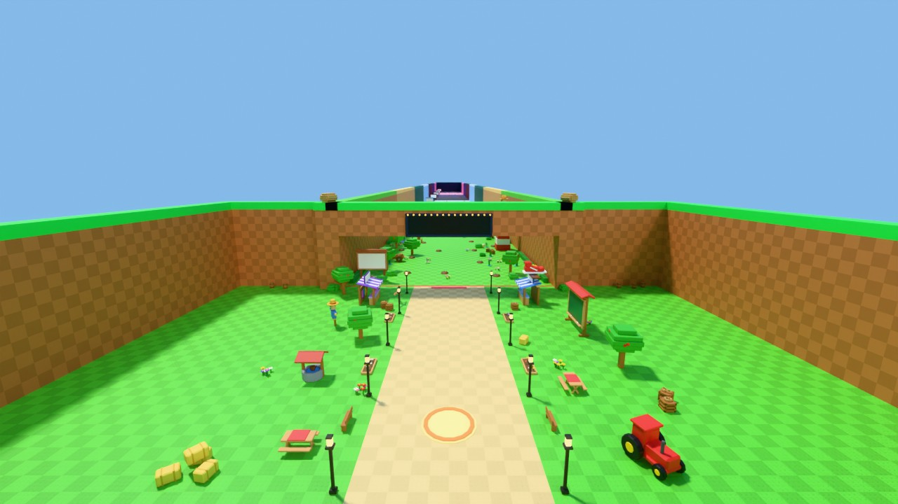
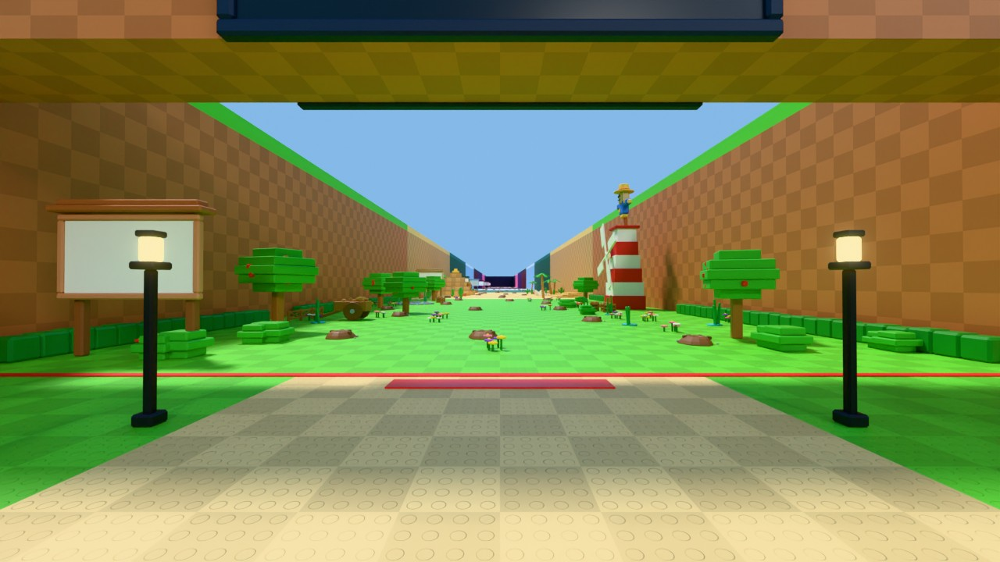

| File | What it is |
|---|---|
| `out/StealAPotato.fbx` | 285 unique meshes (white) plus the four `SAP_Axis` marker cubes |
| `out/BuildStealAPotato.lua` | the unattended build script: builds `Workspace.PotatoMap` and `ReplicatedStorage.PotatoKit`, including the RootMonster's KeyframeSequences |
| `out/RootAnimations.rbxm` | the same four KeyframeSequences as a file (a Folder `RootAnimations`), if you'd rather drag them in |
| `out/potato.json`, `out/stats.json` | what the script builds, as data; mesh triangle counts |
| `previews/` | the renders below |
| `blender/`, `tools/` | the source: `python blender/build_potato.py out` then `python tools/gen_build.py out/potato.json out/BuildStealAPotato.lua out/RootAnimations.json` |

## Put it in the game

1. Upload `out/StealAPotato.fbx` with Open Cloud, load it with `InsertService:LoadAsset` and parent the result anywhere under Workspace. (Or **File → Import 3D**, default settings, "Merge Meshes" off.)
2. Run `out/BuildStealAPotato.lua` with `loadstring` from the command-bar context, or paste it into the Command Bar.

What the script does:
- It finds the meshes inside the import (the container holding the `SAP_Axis` cubes) and undoes any scale or turn the importer applied.
- It keeps a clean copy of every mesh in `ServerStorage.PotatoMeshes`, so it can run again later without a new import.
- It builds `Workspace.PotatoMap` (Model) and `ReplicatedStorage.PotatoKit` (Folder).
- It replaces the ones an earlier run built.
- It deletes only what this run imported, plus the marker cubes. Nothing else in the game is touched.

It is safe to run twice. If it can't find the meshes, it changes nothing and warns.

I dry-ran it in a strict Studio mock: four kinds of import (plain, scaled 0.01, turned, turned and baked), each run again without an import and again with a fresh import, plus a run with nothing loaded. **0 problems**: every instance, CFrame, size, colour, flag, pivot, attribute, joint and all 109 keyframes match the data.

## Rules the map keeps (checked automatically on every build)

- **Budget:** `PotatoMap` is **838 instances** (limit 9,000). Repeated decoration is merged into one MeshPart per area, colour and kind. `PotatoKit` is 249.
- **Running lane:** nothing that collides inside **X −22..22** anywhere in the fields. The gate's beam is overhead at Y 30.
- **Avenue:** nothing stands in **X −20..20** of the yard from the south wall to the gate. Only flat marks lie there: the spawn pad and the red line.
- **Plots:** every plot rectangle is bare ground.
- **Gate:** the opening is clear from the ground to **Y 30** across the full 120 width.
- **Mounds:** 14 per area, at least 16 apart, at least 12 from the walls, at least 20 from the area's ends.
- **Meshes:** nothing thinner than 0.2.
- **Collisions:** only the ground, the walls and a few big simple props collide: stall counters, the barn, the windmill base, the well, the scarecrow tower, the pyramid tiers and the dune steps. Every decoration has CanCollide, CanTouch and CanQuery off, and small ones have CastShadow off.
- **Steps:** the only steps anywhere are the Dunes' sand steps, each exactly 1 stud.

## Names

### Workspace.PotatoMap

| Name | Where / what |
|---|---|
| `Markers/Plot1` … `Plot12` | On the ground at each plot's entrance centre, LookVector into the plot. 1–4 are on the west wall (north to south), 5–8 on the east wall, 9–12 on the south wall (west to east). |
| `Markers/SafeLine` | (0, 0, 0), LookVector north |
| `Markers/Spawn` | (0, 0, 120), an invisible marker. The visible pad round it is `Yard/SpawnPad` + `SpawnRing`, which are flat and don't collide. |
| `Markers/Area1` … `Area8` | One Folder per area, holding the three items below |
| `…/AreaN/Zone` | Invisible, 120 × 60 × 220 over the area's floor. CanCollide, CanTouch and CanQuery are off: read positions against its CFrame and Size, and switch CanTouch on if you'd rather use Touched. Attributes: `Area` (number), `AreaName`. |
| `…/AreaN/Mound` × 14 | The kit's Mound. Its pivot (`Mound:GetPivot()`) is the top centre of the dent, where the seed goes. |
| `…/AreaN/AreaSign` | Model on the west side just inside the area. Its `Board` is 16 × 9, bottom edge at Y 8, front face south. Attribute `Area`. |
| `Gate/TimerSouth`, `Gate/TimerNorth` | 44 × 10, bottom edge at Y 31, front face to the yard / to the fields. Each has a frame and a row of bulbs (`…Bulbs`, Neon, `Flicker`). |
| `Gate/Barrier` | X −60..60, Y 0..30, 1 thick at Z −1. Delivered **off**: Transparency 1, CanCollide off. You colour it and switch it on at night. |
| `Gate/RedLine` | The red safe-zone line, 1.2 wide, X −60..60, flat, doesn't collide |
| `Gate/LineBoard` | 20 × 3, lying face up on the ground just inside the yard. **Write on its Front face** like every other board: its top edge points north, so the text reads right way up for someone walking north. |
| `Gate/Pillar`, `Beam`, caps, `PillarPotato` | The gateway (pillars 12 × 12 × 44 in the wall line) |
| `Yard/TrailShop`, `Yard/SpeedShop` | Models with a flat `Board` (front face to the avenue) and an invisible `Prompt` at chest height in front. TrailShop has a swaying rack of ribbons (`Ribbon`, attribute `Sway`); SpeedShop has a big sneaker on its roof. |
| `Yard/IndexBoard` | The big green chalkboard on legs with a little roof. `Board` is the chalk surface (16 × 10), plus a `Prompt`. |
| `Yard/Barn`, `Yard/Windmill` | Barn front in the south-west corner; windmill in the south-east, with `Sails` (attribute `Spin` = 20; the part's own Y is the axle) |
| `Yard/Lamps/LampPost` × 12 | Lamp posts along the avenue, each a Model with a Neon `Bulb` |
| `Yard/Scenery/*`, `Fields/AreaN/Scenery/*` | Merged decoration meshes |
| `Fields/AreaN/Ground`, `Wall`, `WallCap`, `Border` | Big studded parts. Ground and wall parts carry `Checker = 4`. |
| `Fields/Area1/ScarecrowTower` | Hero of area 1: solid striped tiers, `Sails` (`Spin` = 30) and the scarecrow on top |
| `Fields/Area2/Pyramid`, `Fields/Area2/Dune` | Hero of area 2 (solid tiers with `Checker`, the carved potato on its lane face); the 1-stud sand steps |

**Attributes you can animate:** `Spin` (degrees a second about the part's own Y), `Sway` (on hanging things), `Flicker` (on Neon). **Attachments** on the RootMonster: `Fx_Dirt` (on Root), `Fx_Eyes`, and `Claw` on the two front roots' tips. Part 2 adds `Fx_Smoke`, `Fx_Sparkle`, `Fx_Snow`, `Fx_Embers`, `Fx_Bubbles` and `Fx_Stars` in the areas where they belong.

### ReplicatedStorage.PotatoKit

The kit sits 500 studs under the map. Clone a piece and `PivotTo` it where you want it.

| Name | What it is | Tinted in game? |
|---|---|---|
| `Mound` | Dug soil 5 wide and 1.2 high with a dent, darker clods and pebbles. Pivot at the top centre of the dent. Parts `Heap` (PrimaryPart), `Clods`, `Pebbles`. | no (soil brown) |
| `Soil` | A raised bed 5 × 5 × 0.8 with a wooden border and furrows. Pivot at the top centre. Parts `Dirt` (PrimaryPart), `Rows`, `Border`. | no |
| `Seeds/Seed_Meadow` … `Seed_Cosmic` | About 2.2 tall, pivot at the bottom. `Body` (PrimaryPart), `Sprout`, `Detail` (Candy has three `Detail` parts, one per sprinkle colour; Marsh has two). | **`Body` is light grey (236, 236, 232): tint it.** Sprout and Detail come coloured. |
| `Fences/Fence_Wood`, `Fence_Gold`, `Fence_Neon`, `Fence_Cosmic` | Each tier has a `Post`, a `Rail` and a `GateArch` (Models) | no (tier colours) |
| `…/Post` | 4.5 tall, pivot on the ground at its centre, plus a `Cap`: plain (Wood), gold ball (Gold), crystal (Neon) or Neon star (Cosmic) | |
| `…/Rail` | 7 long between post centres (local X −3.5..3.5): two rails and an X brace. Pivot on the ground halfway between the posts. Neon and Cosmic add Neon strips (Cosmic's are rainbow). | |
| `…/GateArch` | An open doorway 8 wide (local X), 9 high, run through along Z. It has a `Board` on top (front, -Z) and a `BoardBack` (the other side) for the owner's name. Pivot on the ground at the centre. Attribute `OpeningWidth`. | |
| `UpgradeBoard` | A small signboard on a post with a little roof: a `Board` (front, -Z) and an invisible `Prompt` in front. Pivot on the ground under the post. | no |
| `RootMonster` | See below | |
| `RootAnimations` | The four KeyframeSequences | |

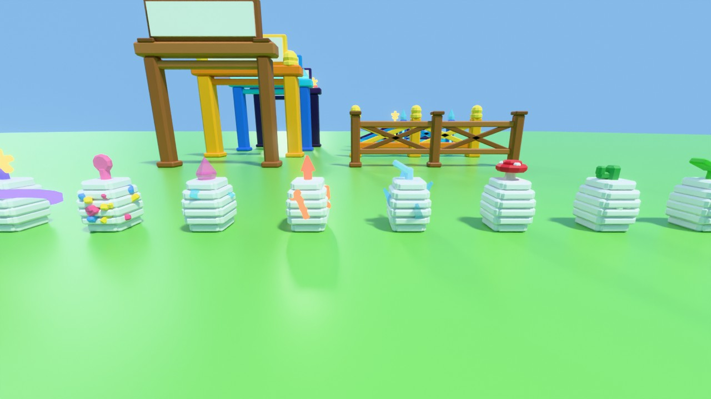
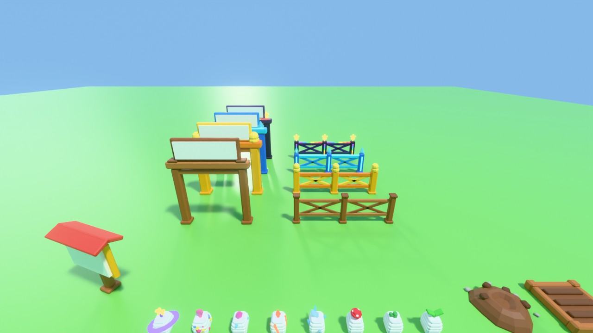
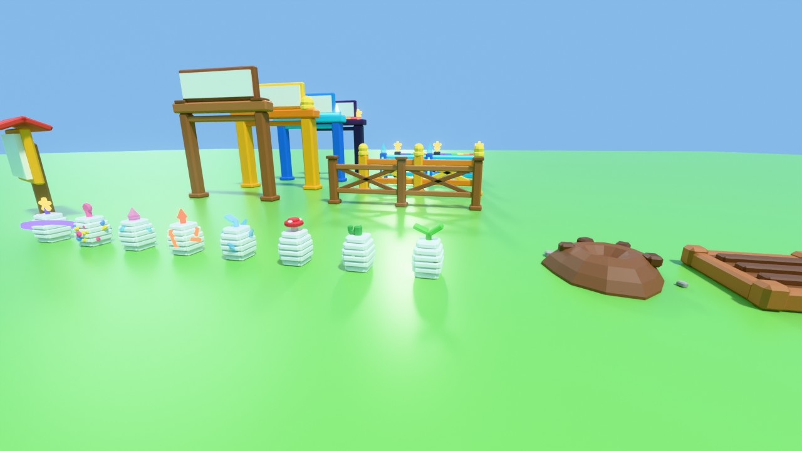

## The RootMonster

A churned heap of dirt 9 wide and 3 high, with six fat knobbly potato roots 6.5 to 9 long. They are brown with paler tips and a few root hairs, and the two front roots end in claw forks. Two small glowing yellow eyes sit deep in a dark hollow in the heap. Scary-funny, not horror.

- **Model** `RootMonster`, front −Z.
- **PrimaryPart** `Root`: invisible, anchored, pivot on the ground in the middle. Every other part is unanchored, massless and non-colliding, and hangs off the joints.
- **Animation:** an `AnimationController` with an `Animator`.
- **Joints:** Motor6D `Heap` (Root → Heap), then a chain of 5 per root, each Motor6D named like its Part1:
  - `Tentacle1Seg1` → `Tentacle1Seg2` → … → `Tentacle1Seg5`, and the same for Tentacle2 … Tentacle6
  - Tentacle1/2 are the front claws, 3/4 the sides, 5/6 the back.
  - Each root joint's −Z runs along its segment: a positive turn about X lifts the root, a positive turn about Y swings it to its left.
  - Welded on: `Clods`, `EyeHole`, two Neon `Eye` balls (`Flicker`) and `Hairs`.

| Animation | Length | Loop | Priority | Markers |
|---|---|---|---|---|
| `RootEmerge` | 1.0 s | no | Action | `Out` at 0.3 s, the moment it's fully out of the ground |
| `RootChase` | 0.7 s | yes | Movement | none |
| `RootGrab` | 0.6 s | no | Action | `Hit` at 0.32 s, the moment the roots close |
| `RootWither` | 1.2 s | no | Action | none |

- 30 fps, every key Linear (the motion is already smooth).
- **RootEmerge** starts with every vertex 3.9 studs under the ground, and **RootWither** ends with every vertex 5 under. Both are checked on every build.
- While chasing, the claws dig at most 1.8 studs into the soil.
- In Studio play-tests the build script's sequences play straight away. For the live game, publish each KeyframeSequence (right-click → Save to Roblox) and use the ids.

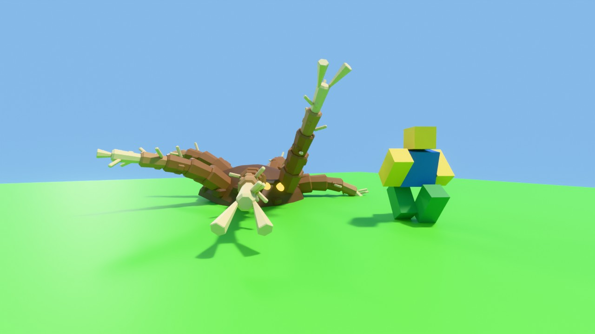
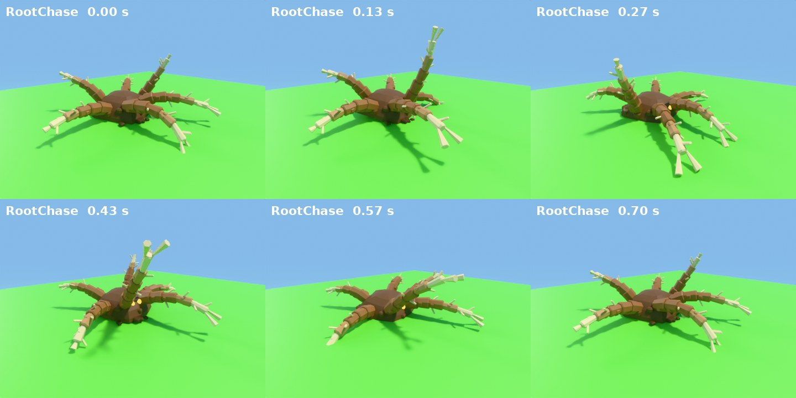
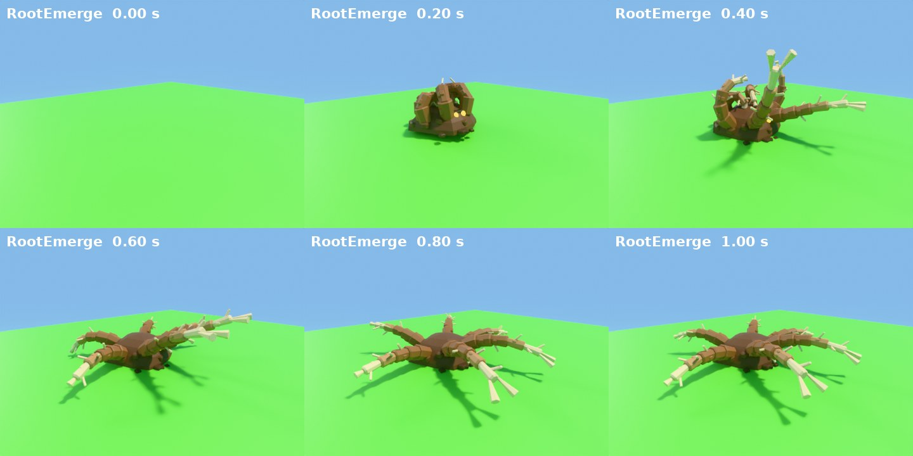
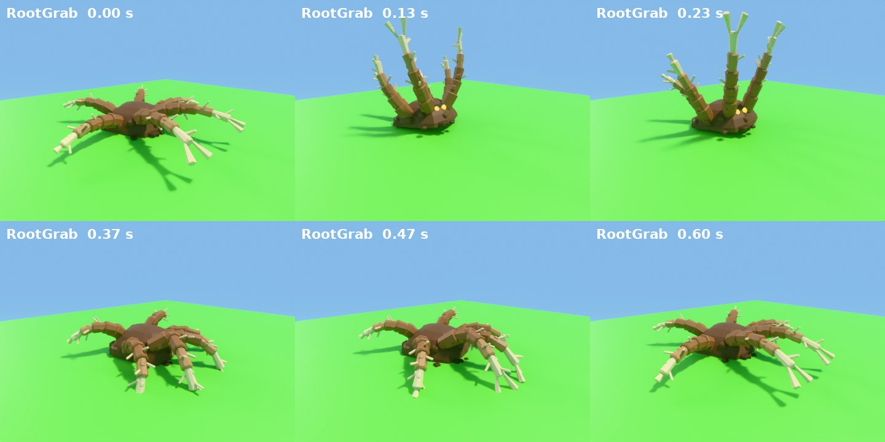
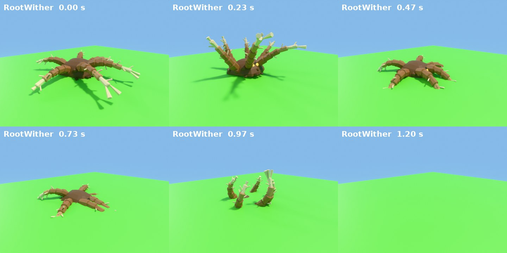

## The map

### The yard

- A walled grass yard 240 × 236, with a sandy avenue down the middle from the south wall to the gate.
- Walls are 44 high and 8 thick, in area 1's brick, with a bright green cap.
- The 12 plots are left bare.
- Round the meeting place:
  - a barn front (south-west corner) and a windmill with turning sails (south-east corner)
  - a well, a tractor, a scarecrow, hay bales, potato crates and a potato pile
  - flower beds along the avenue, 12 lamp posts, benches, picnic tables, apple trees and a signpost
- Near the gate are the three stalls.

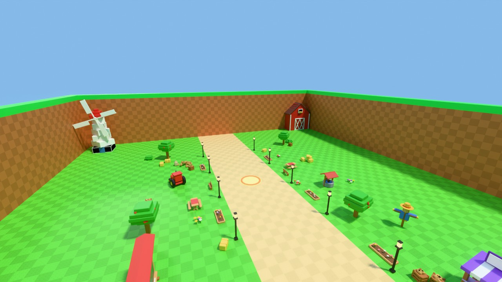
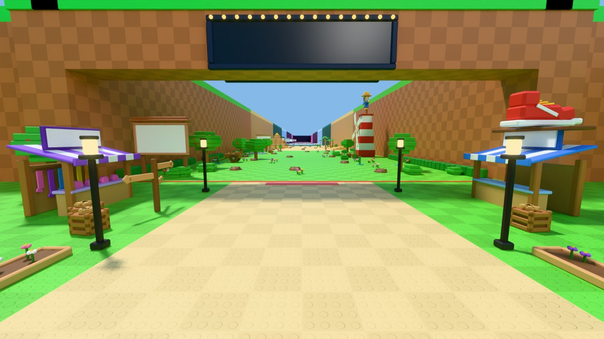

### Meadow Patch (area 1)

- Bright green ground, orange-brown brick walls.
- Along the walls: hedges, apple trees, a wooden cart of potatoes, a round pond with lily pads, reeds and a stone rim (flush with the ground, walk-through), potato crates, bushes, reeds in cyan bases (as in the photos) and flower clumps.
- **Hero:** the red-and-white scarecrow tower against the east wall. It has turning windmill sails on its lane side and a big scarecrow with a potato-sack head and a straw hat on top.

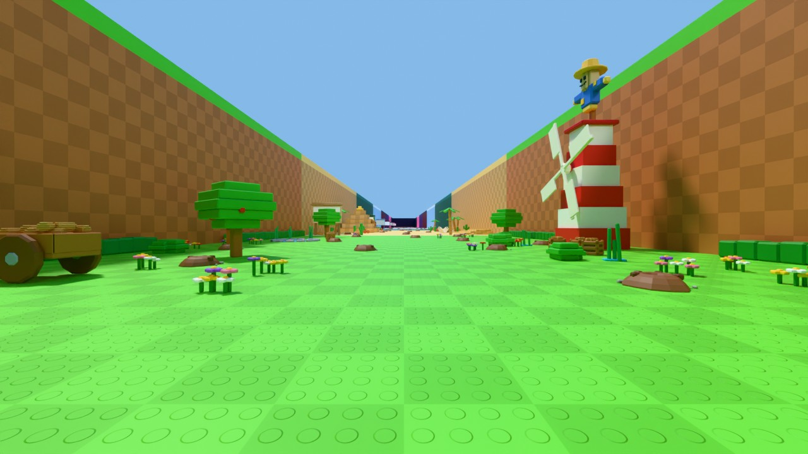

### Sandy Dunes (area 2)

- Sand-yellow ground, tan sandstone walls.
- Palms, cacti, a ribcage and horned skull arching out of the sand, scattered bones, clay pot clusters, a dry well, rocks, and two runs of low solid dune steps against the east wall.
- **Hero:** the stepped pyramid against the west wall, as in the photos. A big potato with a smile and sprouts is carved on its lane face.

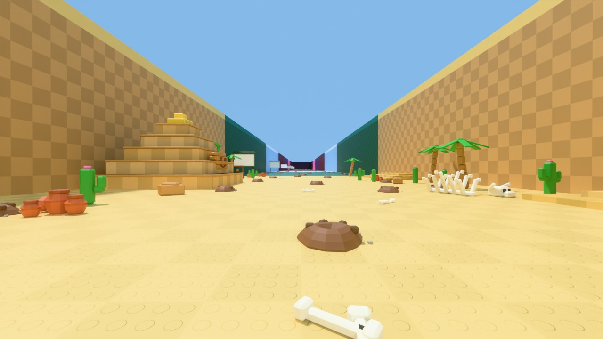
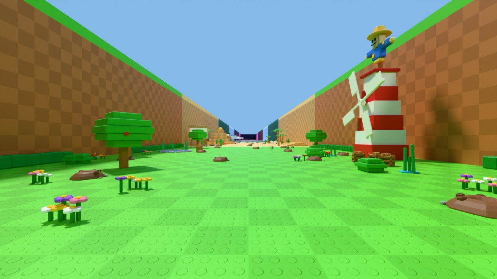

## Part 2 (coming)

Areas 3 to 8, dressed with their heroes:
- 3: the hollow mushroom house
- 4: the ice castle gate tower
- 5: the volcano with its lava fall
- 6: the giant crystal
- 7: the three-tier cake
- 8: the ringed planet on the back wall (`Spin` = 6)

They'll also get the `Fx_*` attachments. Same names, same script: re-running it replaces the map in place.
